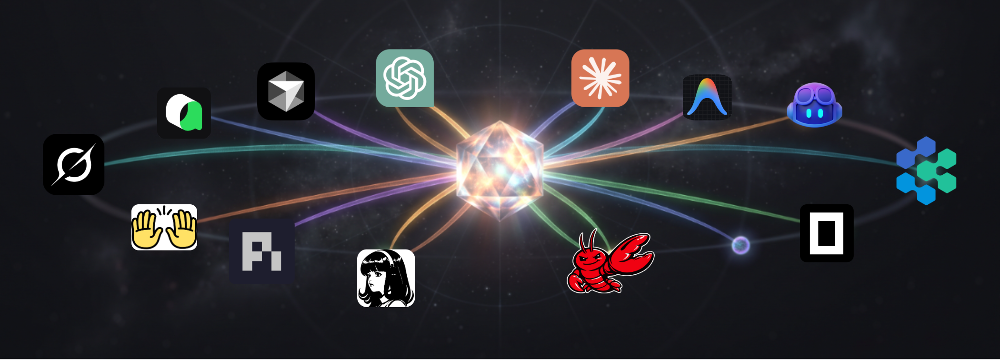
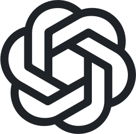
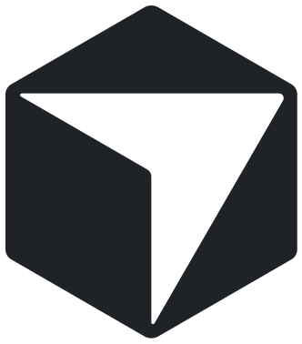
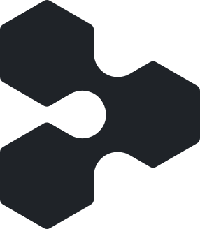
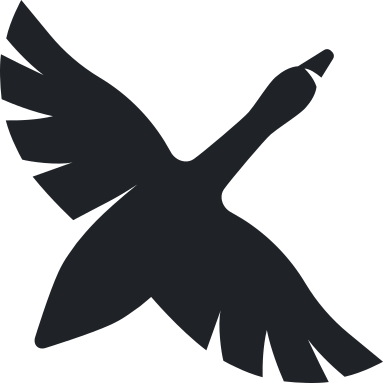
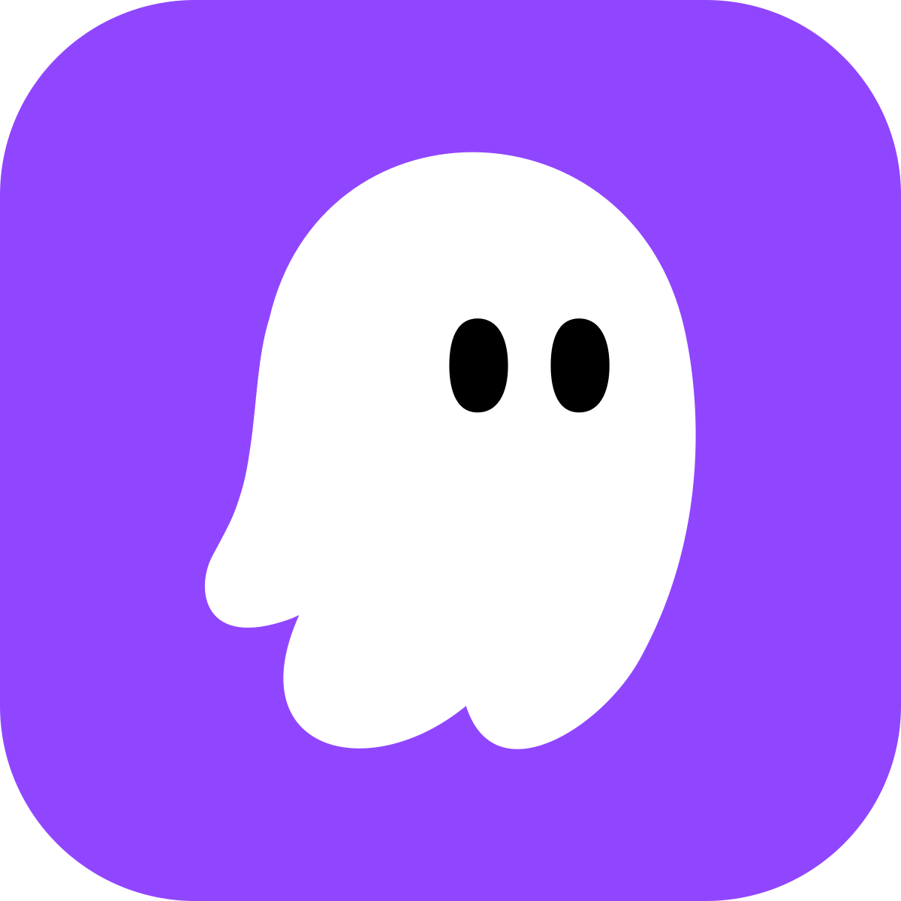
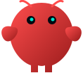
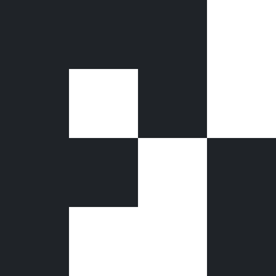

# Subagent CLI Skills 🧔🏻👶🏻

A collection of Skills that connects agents from any vendor to each other.

Let Claude Code prompt Codex, Antigravity or Pi as a subagent. All agents can call each other as subagent. Supports 24
agents.

## How It Works

Almost every coding agent has a headless mode. This mode runs the agent from the terminal with one
command. Each skill in this repository teaches your main agent how to call one other agent in this
way.

<p align="center">
  
</p>

Each skill also applies a delegation and context transfer protocol. The subagent starts with an
empty context. The protocol sends the goal, the decisions and the scope with every command. The
subagent then has the state that it needs to do the task correctly.

## 🛠️ Installation

### Option 1: Interactive Installer

Run the installer with curl:

```bash
curl -sSL https://raw.githubusercontent.com/amirkiarafiei/subagent-cli-skills/main/install.sh | bash
```

Or run it locally, if you cloned the repository:

```bash
chmod +x install.sh
./install.sh
```

### Option 2: Give this prompt to your agent

```
Read https://raw.githubusercontent.com/amirkiarafiei/subagent-cli-skills/main/AGENTIC_INSTALLATION.md and follow the instructions to install the Subagent CLI Skills.
```

Your agent finds which tools you have, asks what it needs to know, and installs the skills. See
[AGENTIC_INSTALLATION.md](AGENTIC_INSTALLATION.md).

### Option 3: Download the skill folder

From `./skills/<vendor>/` — it contains `SKILL.md` and `reference.md`

## Example Usage

Name the tool in your request. Your agent then activates the correct skill. You can also type the
slash command yourself. You can name a model for each tool.

**1. Review code with two different agents and models**

```
Ask Codex with GPT-Astra and Hermes with GLM-5.3 to review the code using their subagent cli skills
```

**2. Get the latest documentation**

```
/antigravity-cli Read the latest docs for the Stripe API. List the breaking changes.
```

**3. Build two features at the same time with two different agents**

```
Build the login form with Codex. Build the signup form with OpenCode.
```

**4. Get fresh ideas on a plan from three different agents**

```
Ask Pi and Grok and Devin to analyze the plan to get fresh and diverse ideas.
```


## 🔌 Support

<p>
 Antigravity ·
 Claude Code ·
 Cline ·
 Codex ·
 Copilot ·
 Cursor ·
 Deep Agents Code ·
 Devin ·
 Gemini ·
 Goose ·
 Grok ·
 Hermes Agent ·
 Junie ·
 Kilo Code ·
 Kimi Code ·
 Kiro ·
 Mistral Vibe ·
 Oh My Pi ·
 OpenClaw ·
 OpenCode ·
 OpenHands ·
 Pi ·
 Qoder ·
 Qwen Code
</p>

## Delegation and Context Transfer Protocol

The delegation technique and philosophy used in this project are inspired by the principles outlined
in **[Don't Build Multi-Agents](https://cognition.ai/blog/dont-build-multi-agents#applying-the-principles)**
by Cognition AI:

We implement a stateless delegation pattern that offloads tactical work to CLI subagents by injecting
a comprehensive "shared state" into every atomic command to prevent context fragmentation.

- **Shared State Handoff**: Inject the original goal, prior architectural decisions, and explicit
codebase scope into the prompt to bridge the subagent's lack of session history.
- **Contextual Preservation**: Execute high-volume tasks in isolated headless environments to save
orchestrator tokens and avoid "split story" failures caused by missing history.
- **Result Reconciliation**: Pull new technical assumptions and filesystem changes back into the main
thread after every delegation to maintain a single source of truth.

This methodology is further refined by lessons from **[Superpowers](https://github.com/obra/superpowers)**
and **[Claude Code](https://github.com/anthropics/claude-code)**, incorporating rigorous verification
loops and context hygiene to ensure subagents remain aligned with the primary orchestrator.

## License

This project is licensed under the MIT License - see the [LICENSE](LICENSE) file for details.